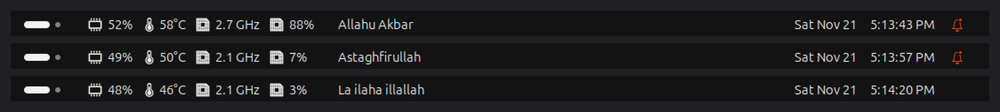

<p align="center"></p>

# Dhikr Bar

A small GNOME Shell extension that shows one dhikr at a time in the top bar.



- Dhikr are shown in English, one after another (in order or random).
- Settings: add, edit and delete dhikr; change the interval (default 30 s); choose left / center / right; limit the length.
- Works on GNOME Shell 50. Update `shell-version` in `metadata.json` for other versions.

## Install

```bash
git clone git@github.com:arifislam-me/dhikr-bar.git
cd dhikr-bar
glib-compile-schemas schemas
ln -sfn "$PWD" ~/.local/share/gnome-shell/extensions/dhikr-bar@arif-islam
```

On Wayland a new extension is only picked up after you log out and log in once. Then:

```bash
gnome-extensions enable dhikr-bar@arif-islam
gnome-extensions prefs dhikr-bar@arif-islam
```

Watch for errors:

```bash
journalctl -f -o cat /usr/bin/gnome-shell
```

## Files

- `metadata.json`: name, uuid, supported shell version.
- `extension.js`: the top bar label and timer.
- `prefs.js`: the settings window.
- `schemas/`: GSettings keys (`dhikr-list`, `interval`, `order`, `position`, `max-length`).
- `icon.svg`: project icon.

## License

MIT, see `LICENSE`.
